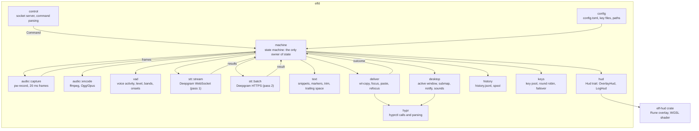
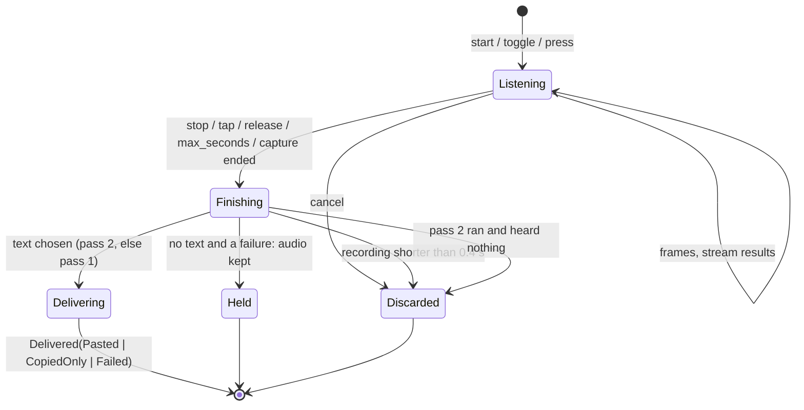
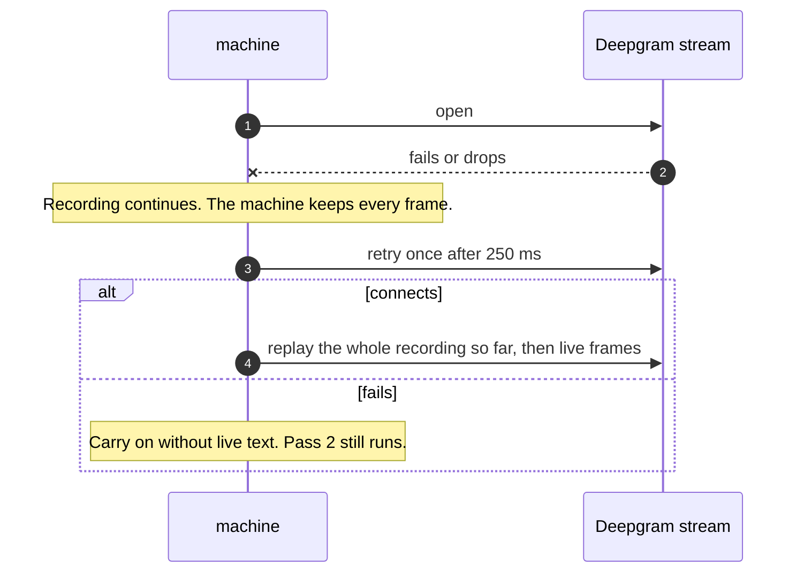
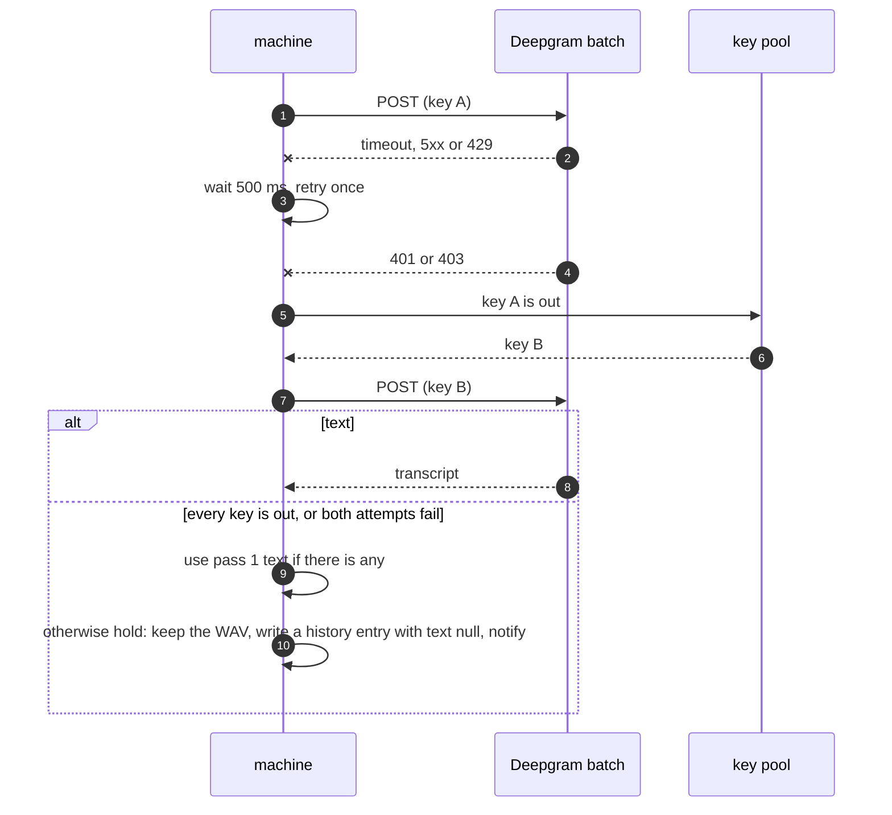
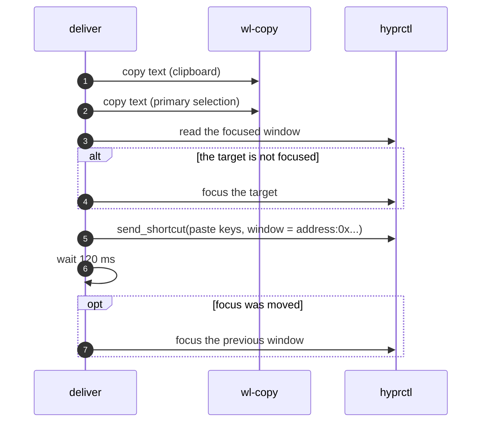

# Architecture

This document describes how ELF is built: the processes, the modules inside the daemon, the
threads, the dictation state machine and the main message sequences. What ELF does in each
situation is in [behaviour.md](behaviour.md).

Terms used below:

- **Daemon (`elfd`)**: the background process that records, transcribes and pastes.
- **CLI (`elf`)**: a small client. A Hyprland key bind runs it; it sends one command to the daemon.
- **Pass 1**: the optional live stream to Deepgram, used for live text and as a fallback.
- **Pass 2**: one request that sends the whole recording. Its text is the one that gets pasted.
- **Interim / final**: a stream result Deepgram may still change / one it will not change.
- **Port**: a trait through which the state machine reaches the outside world. Tests replace
  every port with a fake.

## 1. System context

```
                      exec                Unix socket
  Hyprland bind ───────────────▶ elf ───────────────────▶ elfd
  (SUPER+M ...)                  (CLI)   $XDG_RUNTIME_DIR/elf.sock
                                                            │
        PipeWire ── pw-record ── 16 kHz mono s16le ────────▶│
                                                            │
        Deepgram  ◀── wss  /v1/listen   (pass 1, optional) ─┤
        Deepgram  ◀── HTTPS /v1/listen  (pass 2, always)   ─┤
                                                            │
        ffmpeg    ◀── PCM ── Ogg/Opus while recording ──────┤
        Hyprland  ◀── hyprctl: focus, send_shortcut, submap ┤
        Wayland   ◀── wl-copy (clipboard + primary) ────────┤
        Overlay   ◀── phase + voice frames (layer-shell) ───┤
        Disk      ◀── history.jsonl, spool/*.wav, elfd.log ─┘
```

`elfd` runs as a systemd user service and allows one instance (the socket doubles as the lock).
`elf` accepts `start | stop | toggle | press | release | cancel | paste-again | retry |
history [n] | status | quit`, sends the line, prints the reply and exits.

## 2. Crates and modules



**Rule: only `machine` changes dictation state.** Every other module sends it an `Event` over a
channel, so no two threads race on the same dictation.

| Crate | Module | Responsibility |
|---|---|---|
| `elf` | `machine` | The state machine. Owns all sessions, timers and the HUD phase. Ports are traits. |
| | `control` | Socket server, `Command` parsing, the client `request`. |
| | `audio` | `capture` (`pw-record`), `encode` (ffmpeg to Ogg/Opus while recording), `wav` (44-byte header). |
| | `vad` | `Vad` trait and its default implementation: voice activity, level, 8 spectrum bands, onsets. |
| | `stt` | Request parameters and JSON parsing; `stream` (WebSocket) and `batch` (HTTPS). |
| | `text` | Snippets, dictation markers, trim, trailing space. |
| | `deliver` | Clipboard, focus, paste keys, refocus. |
| | `hypr` | `hyprctl` calls and output parsing; the one place that knows the window selector format. |
| | `desktop` | Focused window, the `elf` submap, `notify-send`, start and stop sounds. |
| | `history` | `history.jsonl` and `spool/`. |
| | `keys` | Key sources, round robin, per-key health. |
| | `config` | `config.toml`, locations of config, state, socket. |
| | `hud` | `Hud` trait; `OverlayHud` drives `elf-hud`, `LogHud` only logs. |
| | `daemon`, `simulate` | Wiring for `elfd` and for `elfd --simulate`. |
| `elf-hud` | `liquid` | The compositor and spring-smoothed inputs for the shader. |
| | `liquid.wgsl` | The shape: waveform, two-lobed processing shape, drop. |
| | `layout` | Size and placement from the monitor. |
| | `ink` | White or dark ink from the screen behind the overlay. |
| | `settings` | The `[hud]` section: parsing, range clamping, reload on change. |
| | `mic` | Voice analysis for the standalone `elf-hud` binary. |

## 3. Threads

| Thread | Owns | Talks to |
|---|---|---|
| Main | The overlay's Rune event loop | Receives `Handle` calls: `show(phase)`, `hide()`, `voice(frame)`. |
| State machine | All dictation state | Receives `Event`s; calls the ports. |
| Control server | The Unix socket | Sends `Event::Command` to the machine and waits for the reply. |
| Capture, one per dictation | The `pw-record` child | Sends `Event::Frame` (20 ms of PCM). |
| Stream worker, one per dictation | The WebSocket | Sends `Event::Stream`. |
| Batch request | One HTTPS request | Sends `Event::Batch`. |
| Delivery queue | `wl-copy` and `hyprctl` calls | Sends `Event::Delivered`. Runs in order so two pastes never interleave. |

Without a display the overlay cannot start. That is logged and `elfd` continues with `LogHud`.
The overlay opens no microphone in the daemon: the machine analyses each captured frame once
and passes the result to the overlay.

## 4. State machine

A dictation is a `Session`. It moves through three stages. Only one session is `Listening` at a
time; earlier ones may still be `Finishing` or `Delivering` while a new one records.



HUD phase per stage:

| Moment | Phase | Shape |
|---|---|---|
| Listening | `Listening` | Waveform that follows voice activity and loudness |
| Finishing | `Processing` | Two lobes with the weight sloshing between them |
| Delivered | `Done` | The lobes gather into a drop that shrinks away (hidden after 450 ms) |
| Nothing heard | `NothingHeard` | The `Done` shape, without any error colour (hidden after 1 s) |
| Held / failed | `Failed` | A calm flat line in a soft tint, then drawn in (hidden after 1.6 s) |

At stop, pass 2 starts immediately and the stream flushes in parallel. As soon as pass 2
returns text, that text is delivered. Pass 1 text is used only when pass 2 returned nothing or
failed, and only after the stream has closed or a 1.5 s flush wait has run out.

## 5. Sequences

### 5.1 Normal dictation

```mermaid
sequenceDiagram
    autonumber
    actor You
    participant Hypr as Hyprland
    participant CLI as elf
    participant M as machine
    participant Cap as capture
    participant Enc as ffmpeg
    participant WS as Deepgram stream
    participant B as Deepgram batch
    participant D as deliver

    You->>Hypr: SUPER+M
    Hypr->>CLI: exec elf start
    CLI->>M: "start" over the socket
    M->>M: read the focused window (target); pick a key
    M->>Hypr: enter the elf submap
    M->>Cap: start pw-record
    opt live_stream = true
        M->>WS: open wss://api.deepgram.com/v1/listen
    end
    M->>B: warm up the HTTPS connection
    loop every 20 ms
        Cap->>M: Frame (640 bytes)
        M->>Enc: PCM
        M->>WS: PCM (if the stream is up)
    end
    You->>Hypr: Space
    Hypr->>CLI: exec elf stop
    CLI->>M: "stop"
    M->>Cap: stop
    M->>Enc: finish, get Ogg/Opus
    M->>B: POST the recording (pass 2)
    M->>WS: finish (flush)
    B-->>M: transcript
    M->>M: text::finalize (snippets, markers, trailing space)
    M->>D: deliver(text, target)
    D->>Hypr: focus target, send_shortcut, focus previous
    D-->>M: Delivered(Pasted)
    M->>M: append history, delete the spooled WAV
```

### 5.2 Stream drop



### 5.3 Failed pass 2



### 5.4 Delivery



If the target window no longer exists, no key is sent. The text stays on the clipboard and in
history, and a notification names `elf paste-again`.

## 6. Voice analysis and HUD

`vad` and `elf-hud::mic` use the same analysis: speech against silence and steady noise,
loudness with automatic gain, the shape of the spectrum in 8 bands, and syllable onsets (positive
spectral flux well above its running mean, at most one per 100 ms). Loudness is scaled between
the room's noise floor and the recent speaking peak. The peak learns only from speech-like sound,
so a slammed door does not shrink your voice.

The overlay is a layer-shell surface without keyboard focus. Every input to the shader is
smoothed by springs on the CPU, so the shape cannot jump.

Each time the overlay is shown:

1. The target monitor is chosen: the focused one, or `hud.monitor`.
2. The size is computed from the monitor's logical size: it grows with the square root of the
   shorter side, between 0.8 and 1.45 times a 225 x 120 design size, then multiplied by `hud.size`.
3. The gap to the edge is 6.5% of the logical height, between 24 and 160 px, unless
   `hud.y_offset` is set. Reserved areas such as bars are cleared first.
4. With `color = "auto"`, a strip of screen next to the overlay is sampled (`grim`, never written
   to disk) when it shows and then every second. Ink turns near-black above a mean luminance of
   0.45 and white below 0.35, with a crossfade of about 350 ms. Without `grim` the ink stays white.

The `[hud]` section is re-read whenever `config.toml` changes. A broken file keeps the last good
settings and sends one notification that names the line.

## 7. Deepgram usage

| Feature | Pass | Parameter or message |
|---|---|---|
| Model | both | `model=nova-3` |
| Punctuation, capitals, numbers | both | `smart_format=true` |
| Spoken punctuation | both | `dictation=true` (only with `spoken_punctuation = true`) |
| Vocabulary | both | `keyterm=<term>`, up to 100 |
| Language | both | `language=<language>` |
| Training opt-out | both | `mip_opt_out=true` |
| Raw audio | stream | `encoding=linear16&sample_rate=16000&channels=1` |
| Live guesses and endpointing | stream | `interim_results=true&endpointing=300&utterance_end_ms=1000&vad_events=true` |
| Keep alive | stream | `{"type":"KeepAlive"}` every 8 s with no audio sent |
| Flush and close | stream | `{"type":"Finalize"}`, `{"type":"CloseStream"}` |

Pass 2 uploads Ogg/Opus at 32 kbps (about a tenth of the WAV size), encoded by ffmpeg during the
recording. If ffmpeg fails, the WAV is uploaded instead. Deepgram closes idle HTTPS connections
after a few seconds, so the connection is opened at start and touched every 2 s. The request
timeout is 6 s plus 0.3 s per second of audio.

`dictation=true` makes Deepgram turn spoken commands into symbols, but it turns off automatic
punctuation. That is why `spoken_punctuation` is an option and off by default. Deepgram writes
"new line" and "new paragraph" as the markers `<\n>` and `<\n\n>`; `text` converts them to real
newlines.

## 8. Testing

The state machine is tested through fake ports with a controllable clock, so every row of the
scenario table in [behaviour.md](behaviour.md) has a test (`scenario_N_...`). `deliver`,
`keys`, `config`, `text`, `history` and the HUD layout and ink code have their own unit tests.
`ELF_MIC_FILE=<file>` replaces `pw-record` with a file decoded by ffmpeg in real time, and
`elfd --simulate <file.wav> --dry-run` runs one dictation against the real Deepgram API without
pasting anything.
